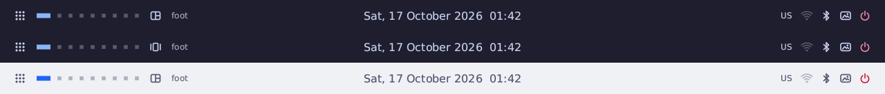
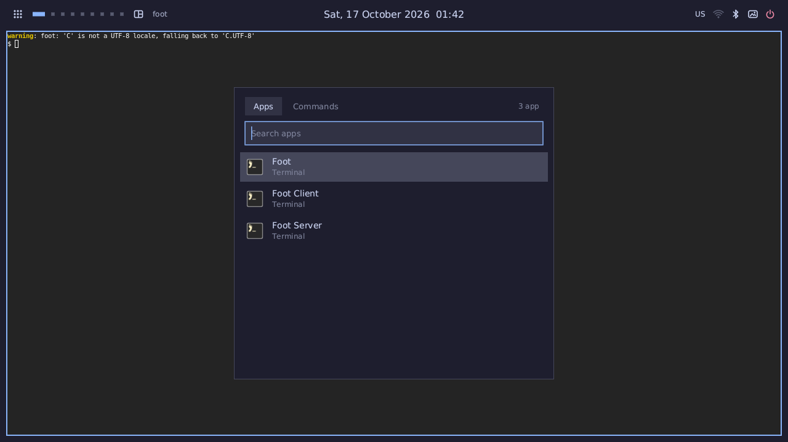
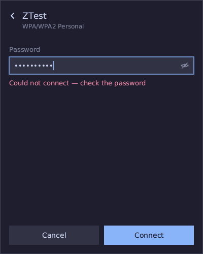
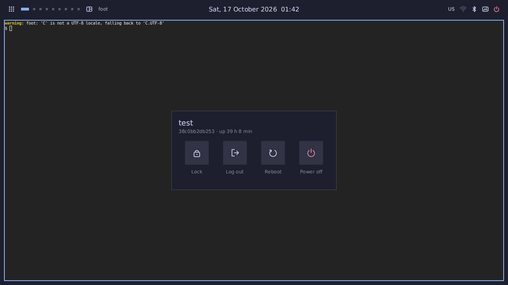

# RefursLine

Бар для [RefursWM](https://github.com/FalconBinary/RefursWM) на чистом Zig: без libc, без libwayland и без сторонних библиотек. Работает **только** в RefursWM: рабочие столы, заголовок окна, режим раскладки, раскладку клавиатуры и тему он получает по своему протоколу `refurs-shell`, который RefursWM даёт только бару, запущенному им самим.

Это продолжение [netline](https://github.com/FalconBinary/netline): код меню, отрисовки, шрифтов, декодеров изображений, Wi‑Fi и Bluetooth взят оттуда и переделан под RefursWM.



| Лаунчер | Wi‑Fi (iwd) | Питание |
|---|---|---|
|  |  |  |

## Что умеет

- **Рабочие столы 1–9.** Активный, занятый, показанный на другом мониторе. Клик переключает, колесо листает.
- **Режим раскладки стола** (dwindle или scroll). Клик переключает.
- **Заголовок окна в фокусе.** Длинный обрезается многоточием по границе символа.
- **Часы и календарь.**
- **Раскладка клавиатуры** (US, RU).
- **Wi‑Fi** через iwd: список сетей, WPA/WPA2/WPA3 Personal, скрытые сети, «забыть», радио вкл/выкл.
- **Bluetooth** через BlueZ: поиск, сопряжение со своим агентом, подключение, заряд, Bluetooth по требованию.
- **Батарея.** Заряд и зарядка; если батареи нет, значок скрыт.
- **Обои.** Выбор с миниатюрами или случайные.
- **Лаунчер** приложений и команд с нечётким поиском и иконками.
- **Меню питания:** блокировка, выход, сон, гибернация, перезагрузка, выключение.
- **Тема** тёмная или светлая — та же, что у RefursWM, переключается сразу, по Super+Shift+T. Цвета у бара свои (`config.zig`) и от цветов RefursWM не зависят. Всё рисуется сплошными цветами: без скруглений, прозрачности и затемнения вокруг меню.
- **Монитор.** Своя панель на каждом, подключение «на ходу», дробный масштаб.

## Установка

Нужны:
- Linux на x86_64, aarch64 или riscv64;
- Zig 0.17;
- RefursWM с протоколом `refurs-shell`.

Для меню нужны iwd, bluetoothd и шрифт TrueType (DejaVu Sans или Noto Sans).

```bash
git clone https://github.com/FalconBinary/RefursLine && cd RefursLine
```

```bash
zig build
```

```bash
sudo install -m 755 zig-out/bin/refursline /usr/local/bin/refursline
```

Больше ничего делать не нужно: в конфиге RefursWM (`src/config.zig`) бар уже прописан.

```zig
pub const bar = "/usr/local/bin/refursline";
pub const grants = [_]t.Grant{ .{ .path = bar, .caps = .{ .shell = true } }, ... };
pub const autostart = [_]t.Cmd{ &.{bar}, ... };
```

Grant выдаётся по **точному абсолютному пути**. Ставите бар в другое место — поменяйте `bar` в конфиге RefursWM и пересоберите его. Бар, запущенный из терминала, сразу выходит: протокола `refurs-shell` у него нет.

### Хоткеи (конфиг RefursWM)

| Клавиши | Действие |
|---|---|
| `Super+D` / `Super+Shift+D` | лаунчер: приложения / команды |
| `Super+N` | Wi‑Fi |
| `Super+B` | Bluetooth |
| `Super+P` | обои |
| `Super+C` | календарь |
| `Super+Escape` | питание |
| `Super+Shift+B` | перезапустить бар (если упал) |

### Мышь

| Элемент | ЛКМ | ПКМ |
|---|---|---|
| лаунчер | приложения | команды |
| столы | перейти (колесо — листать) | — |
| режим | dwindle ↔ scroll | — |
| часы | календарь | — |
| Wi‑Fi | меню | радио вкл/выкл |
| Bluetooth | меню | вкл/выкл |
| обои | выбор | случайные |
| питание | меню | заблокировать |

## Настройка

Конфиг вкомпилирован, как у RefursWM. Порядок такой:
1. Правите `src/config.zig`.
2. Запускаете `zig build` и `sudo install …`.
3. Перезапускаете бар хоткеем Super+Shift+B.

Ошибка в конфиге — ошибка сборки, при запуске ничего не разбирается.

В `config.zig`:
- элементы слева, по центру и справа;
- геометрия, шрифты, формат часов;
- две палитры бара, тёмная и светлая: цвета `#RRGGBB` (только непрозрачные) для панели, подсветки, рабочих столов, значков, меню и полей обоев. Они отдельные от цветов RefursWM — те настраиваются в его `config.zig`;
- каталог и режим обоев (`fill` / `fit`);
- команды reboot и poweroff без logind (doas, с запасной командой sudo);
- Bluetooth по требованию;
- тема иконок и терминал для лаунчера.

## Как устроено

```
RefursWM ──(сокет от launcher, WAYLAND_SOCKET, grant .shell)──► refursline (бар + обои)
   │  refurs-shell: столы, фокус, раскладка, тема, «открой меню»          │ fork до песочницы
   │                                                                     ▼
   └── обычный wayland-0 ◄── меню (refursline run|wifi|bt|wall|power|cal) ◄── broker
                               fd 3: канал к бару (обои, питание)
```

**Один бинарник, несколько режимов.** Без аргументов это бар, с аргументом — меню. Код общий, и страницы файла в памяти тоже общие. На диске один файл на 552–640 КБ вместо восьми.

**В покое два процесса: бар и broker.** Меню живут как отдельные процессы только пока открыты. Каждое — в своей песочнице и со своим соединением Wayland без привилегий.

**Протокол `refurs-shell`** (`protocol/refurs-shell-unstable-v1.xml`):
- События приходят пачкой с `done` в конце.
- RefursWM собирает изменения за проход цикла событий в одну отправку и шлёт только разницу. Таймеров нет, опроса нет.
- Бар может попросить только:
  - показать стол;
  - листать столы;
  - переключить режим;
  - переключить тему;
  - заблокировать экран командой из конфига RefursWM;
  - завершить сессию.
- Запустить программу через RefursWM бар не может.

**broker.** Запускает меню через `execveat` по O_PATH-дескриптору собственного файла, открытому при старте. Нет ни shell, ни PATH, ни строки команды. Тема передаётся аргументом и проверяется по маске.

**Обои.**
- Декодируются (свои PNG/JPEG, SIMD) один раз под размер самого большого монитора.
- Буфер отдаётся RefursWM. После `wl_buffer.release` бар его уничтожает, и пиксели остаются только в текстуре компоновщика.
- Без выбранных обоев поверхности нет вовсе: виден фон RefursWM.

**Отрисовка.**
- Программная ARGB8888 со сглаживанием через SDF.
- Смешивание — SIMD по 8 пикселей с точным делением на 255; результат бит в бит как у скалярного пути (тест в `draw.zig`).
- Бар перерисовывает только изменившиеся элементы: каждому соответствует отпечаток его состояния.
  - Если компоновщик уже отпустил буфер, правка идёт прямо в нём, без копирования.
  - Компоновщику уходят прямоугольники изменённых элементов.
- Привязки Wayland генерирует `tools/scan.zig` из XML при сборке. Номер запроса и типы аргументов проверяются при компиляции.

## Безопасность

- **Привилегированный протокол** есть только на соединении, которое RefursWM открыл сам, по grant для точного пути. Его не видят:
  - другие клиенты;
  - тот же бинарник, запущенный из терминала;
  - песочницы (flatpak, `wayland-0-sandbox`).

  Проверяется в `tests/security.sh` RefursWM.
- **Бар.** Отказывается работать:
  - от root;
  - без `WAYLAND_SOCKET`;
  - вторым экземпляром (flock в `$XDG_RUNTIME_DIR`).

  Сокет получает `CLOEXEC`, и из окружения запускаемых программ `WAYLAND_SOCKET` убран.
- **Песочница бара:**
  - `NO_NEW_PRIVS`, `DUMPABLE=0`;
  - Landlock: только чтение `/sys`, `/proc`, tzdata и каталога обоев, TCP запрещён, сигналы и абстрактные сокеты — только внутри;
  - seccomp: белый список без exec, fork, socket и connect, `mmap` без `PROT_EXEC`, `openat` только на чтение, один `ioctl` (`HCIGETDEVINFO`).
- **Меню:**
  - своя песочница;
  - D-Bus принимает сигналы только от уникального имени iwd или bluetoothd;
  - агенты паролей и PIN отвечают только им;
  - пароли стираются сразу после передачи.
- **Строки извне.** Заголовок окна, имя раскладки и имена файлов чистятся дважды, в RefursWM и в баре: только целые символы UTF‑8, без управляющих, длина ограничена. Имя обоев — только файл в каталоге обоев.
- **Сборка ReleaseSafe** — проверки границ на месте; static-pie, то есть ASLR для кода.

## Замеры

Условия: headless RefursWM, aarch64, контейнер, монитор 1920×1080, `tests/bench.sh`. Для сравнения — netline 9486f9b в тех же условиях.

| | RefursLine | netline + zbg |
|---|---|---|
| файлы | 1 × 552 КБ (aarch64), 640 КБ (x86_64) | 8 × всего 1,32 МБ / 1,49 МБ |
| процессов в покое | 2 (бар, broker) | 3 (панель, broker, zbg) |
| PSS всех процессов, с обоями | ~0,96 МБ | ~0,94 МБ |
| из них анонимная память | 164 КБ | 204 КБ |
| пробуждений в простое | 0 (часы — раз в минуту) | 0 + переподключение к mango |
| кадр бара целиком / одного элемента | 90–250 мкс / 9–65 мкс | — |

Остальной PSS — общие страницы файла бинарника и шрифта. Их делят все процессы, и ядро может их вытеснить.

## Проверки

```bash
zig build test
```

Модульные тесты, на любой машине: SIMD против скалярного пути, отсечение, тема, разбор `.desktop`, вставка, имена обоев.

```bash
docker run --rm --cap-add SYS_PTRACE -v "$PWD":/src:ro -v refurs-cache:/cache -v ~/out:/out -w /src refurs-dev3 sh tests/headless.sh /cache/testing/bin/refurswm /src/zig-out/bin/refursline /out
```

Вживую. RefursWM собран с `-Dtesting=true`, образ `refurs-dev3` из репозитория RefursWM. Проверяется:
- запуск из автозапуска с grant;
- два процесса;
- `NO_NEW_PRIVS` и seccomp;
- дескрипторы broker;
- ноль пробуждений в простое;
- меню по хоткеям, повторный хоткей закрывает меню;
- в окружении меню нет `WAYLAND_SOCKET`;
- клики по столам;
- случайные обои;
- отказ при запуске из терминала и вторым экземпляром.

`tests/bench.sh` — замеры против netline.

Wi‑Fi и Bluetooth проверены в VM: iwd + mac80211_hwsim + hostapd, bluetoothd + btvirt. Прошли:
- вкл/выкл радио, в том числе при rfkill;
- неверный и верный пароль;
- «забыть»;
- поиск и сопряжение Bluetooth.

**Не проверено на железе:** настоящий DRM, несколько мониторов и их подключение на ходу, дробный масштаб (HiDPI), uevent батареи, события mgmt Bluetooth.

## Лицензия

GPL-3.0-or-later, см. [LICENSE](LICENSE). XML протоколов в `protocol/` — из wayland, wayland-protocols и wlr-protocols, их лицензии (MIT и подобные) — в самих файлах; `refurs-shell-unstable-v1.xml` — из RefursWM.
